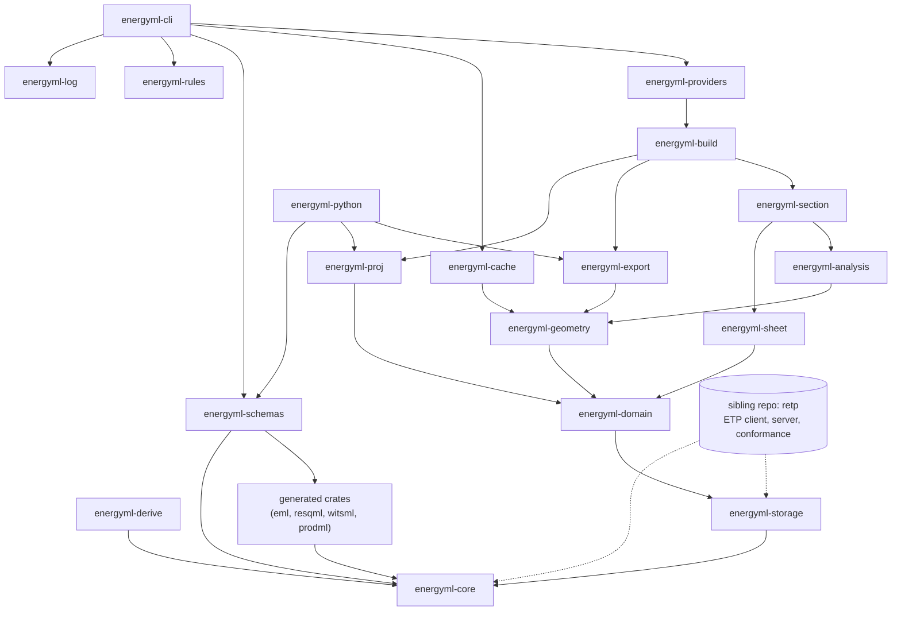

# Architecture

`energyml-rust` is a Rust workspace to read, write and compute EnergyML data (RESQML, WITSML, PRODML and the common EML). It is layered: each crate depends only on crates below it, and the lowest layers build for `wasm32`.

## The stack

Reading from the bottom: `core` knows nothing about any schema; the generated crates sit on it; `schemas` gathers them in one registry; `storage` reads and writes stores; `domain` gives meaning (units, CRS, values, properties); `geometry` turns representations into points; everything above that consumes geometry. `rules` and `log` are leaves that any crate can use. `cli` and `python` are the faces. `energyml` (the facade crate) re-exports the library crates and sits beside the faces.

## Crates

| Crate | Role |
|---|---|
| `energyml` | The facade: re-exports the public library crates under short module names (`energyml::storage`, `energyml::geometry`, …) so that an application takes one dependency. No code of its own. |
| `energyml-core` | Runtime for generated code: XML/JSON, reflection, validation, identifiers. No native dependency. |
| `energyml-derive` | Derive macros turning generated structs into `core` trait implementations. |
| `crates/generated/*` | The generated schema crates, one per release family. Never edited by hand. |
| `energyml-schemas` | Every generated version in one `Registry`; the only list of releases. |
| `energyml-storage` | `EnergymlStorage` trait and `EpcStore`: EPC read, edit and rewrite, external HDF5 arrays through backends. |
| `energyml-domain` | Units, CRS, value arrays, statistics, property kinds, colours, tables; one implementation for all versions. |
| `energyml-geometry` | Representations to points and topology: surfaces, IJK and unstructured grids, wells, sub-representations. |
| `energyml-proj` | Reprojection backend over `proj4rs`; pure Rust, wasm included. |
| `energyml-export` | Registry of exporters: OBJ, GeoJSON, VTK. |
| `energyml-cache` | What a package keeps of itself (index, colours, attachment listings); one implementation, optionally off. |
| `energyml-analysis` | Computation from shapes: interpolation, contouring, domain calculations over wells and grids. |
| `energyml-sheet` | Well drilling sheet laid out in Rust and written as SVG. |
| `energyml-section` | Long and cross sections along a trace: catalogue, layout, SVG (PNG optional). |
| `energyml-build` / `-build-derive` | Create objects: a pure operation from inputs to a plan, then `apply` writes. |
| `energyml-providers` | Query public geoscience APIs; request and response are pure, transport is a trait. |
| `energyml-rules` | Registry of the decisions made where the specification is silent or ambiguous. |
| `energyml-log` | The one `tracing` subscriber a face installs; off by default. |
| `energyml-cli` | The `energyml` command. |
| `energyml-python` | Python bridge, wheel `energyml-rust`, import `energyml.rust`. |
| `energyml-tests`, `energyml-roundtrip` | End-to-end tests and the round-trip validator; not published. |

## Invariants, and why

- **`energyml-core` has no native dependency.** WebAssembly is a hard requirement, so everything up to and including geometry (and proj, cache, analysis, sheet, section) must build for `wasm32`. Native code such as HDF5 lives in the storage layer behind optional features.
- **Registries, not `match`.** Where the list will grow (array backends, representation readers, exporters, schema versions, operations, providers), there is a trait and a registry. Built-ins are pushed by default; entries added by the caller are tried first, so a built-in can be replaced, not merely extended.
- **One entry point per access.** An ETP URI is parsed by `EtpUri::parse`; an object is found by `EpcStore::lookup` (`lookup_uuid` and `resolve` are adapters); a colour is decided in `energyml-cache`'s colour module. A second implementation, even a private one, lets two faces answer differently.
- **Full URIs internally.** A bare UUID or a short URI is accepted only at the library boundary and converted at once to a full identity (including the version when the object has one). No key or comparison inside the library uses a bare UUID.
- **Faces hold no logic.** `energyml-cli` parses arguments and prints; `energyml-python` converts. Every check, decision and operation is in a library crate, so the command line, Python and any other face answer the same.
- **Refuse rather than guess.** An ambiguous input yields a named refusal, not a plausible answer; an unsupported representation is an error that names its type. A missing capability is not missing data: a backend that is not compiled in answers `FeatureNotEnabled`, never an empty array.
- **Generated code is never edited by hand.** Fix the generator or the derive macros; regeneration must reproduce the committed output exactly. Do not run `cargo fmt --all`, which would rewrite generated crates; format hand-written crates by name.
- **Decisions are citable.** Where the library interprets a specification, the choice is a rule in `energyml-rules` with references, listed in [`docs/house-rules.md`](docs/house-rules.md).

## Tests

- Each crate keeps its tests in a single binary, `tests/main.rs`; a new test file is a `mod` line there. Many small test binaries each link the large generated crates and exhaust disk on CI runners.
- Run the workspace with `cargo test --workspace`, filtering inside the workspace (`cargo test --workspace <name>` or `--test main`) rather than `-p <crate>`, which changes feature resolution and forces rebuilds.
- Public tests depend on no external file; they build their data in the test or use the Lutetia reference model (see its repository).
- HDF5 targets are not covered by `--all-targets`; the HDF5 job in CI exercises them.
- Tests state rules from the specification, citing document, page and paragraph in a comment; a test that cannot fail proves nothing.

## ETP

The Energistics Transport Protocol (client, server, conformance checks, bridge to `EnergymlStorage`) lives in the sibling repository `retp`. It implements the same `EnergymlStorage` trait, so code written against a file works against a server.

TODO(verify): name and link the Lutetia reference-model repository once it is public.
