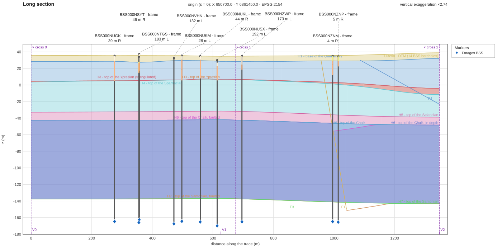

<div align="center">



<sub>A section of <a href="https://github.com/geosiris-technologies/energyml-lutetia">Lutetia</a>, a synthetic model (CC BY 4.0) built on boreholes of the BRGM Banque du sous-sol (Licence Ouverte 2.0), modified for the example.</sub>

# energyml-rust

**Read, write and compute EnergyML (RESQML, WITSML, PRODML) data - Rust, Python, CLI**

[](https://crates.io/crates/energyml-core)
[](https://docs.rs/energyml-core)
[](https://pypi.org/project/energyml-rust/)
[](https://github.com/geosiris-technologies/energyml-rust/actions/workflows/ci.yml)
[](LICENSE)

</div>

EnergyML data travels as **EPC packages**: a zip of XML objects plus HDF5 files holding the big arrays. `energyml-rust` opens them, checks them, edits and rewrites them, turns their representations into points and meshes, and exports the result - with the same behaviour from Rust, from Python and from the command line.

- Every released RESQML, WITSML and PRODML schema version, as typed Rust, with reflection and JSON.
- EPC read and write, tolerant of real-world files and never silent about what it tolerated.
- Units, CRS, value arrays, property kinds, colours, lookup tables.
- Geometry: IJK and unstructured grids, surfaces, well trajectories and frames.
- Export to OBJ, GeoJSON and VTK; reprojection between EPSG systems in pure Rust.
- Pure Rust core: it compiles to WebAssembly. HDF5 is an optional feature.

## Install

```sh
cargo add energyml --features all  # the library; or name the versions you read, e.g. --features resqml22 (TODO(verify): crates.io name)
pip install energyml-rust          # the Python package, imported as `energyml.rust`
cargo install energyml-cli --features hdf5   # the command line: installs `energyml` (alias `enyml`)
```

Pre-built command-line binaries are attached to each [GitHub release](https://github.com/geosiris-technologies/energyml-rust/releases).

## Try it on the reference model

The examples below use **Lutetia**, a synthetic reference model kept in its own repository: [`geosiris-technologies/energyml-lutetia`](https://github.com/geosiris-technologies/energyml-lutetia), file `package/Lutetia.epc` (with its `.h5` beside it).

### Rust

```rust
use std::sync::Arc;
use energyml::storage::EpcStore;

// Needs `energyml = { version = "0.1", features = ["all"] }` (or the versions you read):
// the registry lists the schema versions whose feature is on.
let registry = Arc::new(energyml::schemas::all());
let store = EpcStore::open("Lutetia.epc", registry)?;

for summary in store.resources() {
    let header = store.header(&summary.uri)?;
    println!("{} - {}", header.summary.qualified_type, header.display_name());
}
# Ok::<(), energyml::storage::Error>(())
```

### Python

```python
from energyml.rust.epc import Epc

pkg = Epc.open("Lutetia.epc")
for one in pkg.find("Representation"):
    print(one.qualified_type, one.title)

obj = pkg.get(pkg.objects()[0].uri)        # an object crosses as a dictionary
```

Worked examples, stored with their outputs: [the notebooks](examples/notebooks/) - find your way
around a package, judge one, build one from nothing.

### Command line

```sh
energyml list   Lutetia.epc                    # what the package holds
energyml check  Lutetia.epc                    # everything wrong with it; exit 1 on errors
energyml export Lutetia.epc --format obj --out lutetia-obj/
```

Start with [docs/getting-started.md](docs/getting-started.md) for a ten-minute walk-through.

## Crates

| Crate | What it is |
|---|---|
| `energyml` | The whole library in one dependency: re-exports the crates below under short module names (`energyml::storage`, `energyml::geometry`, …). |
| `energyml-core` | Runtime for the generated code: XML/JSON, reflection, validation, identifiers. No native dependency. |
| `energyml-derive` | Derive macros behind the generated types. |
| `energyml-schemas` | Every generated schema version in one registry. |
| `energyml-storage` | EPC read/write behind one storage abstraction; optional HDF5. |
| `energyml-domain` | Units, CRS, value arrays, statistics, property kinds, colours, tables. |
| `energyml-geometry` | Representations to points and topology: grids, surfaces, wells. |
| `energyml-export` | Geometry to OBJ, GeoJSON and VTK through a registry. |
| `energyml-proj` | Reprojection between EPSG systems over `proj4rs`; wasm included. |
| `energyml-cache` | What a package keeps of itself, layer by layer. |
| `energyml-rules` | The rules the library applies where the specification is silent or ambiguous. |
| `energyml-log` | The one `tracing` subscriber a front end installs. |
| `energyml-sheet` | A drilling sheet laid out in Rust and written as SVG. |
| `energyml-section` | Long and cross sections of a model along a trace, as SVG. |
| `energyml-analysis` | Computation on shapes: interpolation and more. |
| `energyml-build` | Create objects from geometry or foreign files: operations, plans, recipes. |
| `energyml-build-derive` | Derive macros for `energyml-build` operations. |
| `energyml-providers` | Query public geoscience APIs. |
| `energyml-cli` | The `energyml` command. |
| `energyml-python` | The Python bridge (`pip install energyml-rust`). Not published to crates.io. |
| `energyml-tests`, `energyml-roundtrip` | End-to-end tests and the structural round-trip validator. Not published. |
| `crates/generated/*` | Twelve crates generated from the Energistics schemas - see [crates/generated/README.md](crates/generated/README.md). |

The architecture and each crate's role are in [ARCHITECTURE.md](ARCHITECTURE.md).

## Documentation

- [Getting started](docs/getting-started.md)
- [Library guide](docs/library.md)
- [Command line](docs/cli.md)
- [Python](docs/python.md), and its [notebooks](examples/notebooks/)
- [Gallery](docs/gallery.md) - every image, with the command that produced it
- [Architecture decision records](docs/adr/)

## Made by Geosiris

`energyml-rust` is developed by [Geosiris](https://www.geosiris.com). A public web application built on this library is coming - TODO(verify): link when it is live.

## Disclaimer and notices

This library is developed by Geosiris and is **not affiliated with or endorsed by Energistics or The Open Group**. Energistics®, RESQML™, WITSML™ and PRODML™ are trademarks or registered trademarks of Energistics Consortium, Inc. The generated crates are derived from Energistics standards; see [NOTICE](NOTICE).

## License

[Apache-2.0](LICENSE). Third-party attributions are in [NOTICE](NOTICE).

## Citation

If you use this software in research, please cite it with the metadata in [CITATION.cff](CITATION.cff) (GitHub's "Cite this repository" button reads it).

## Contributing

See [CONTRIBUTING.md](CONTRIBUTING.md). Security issues: [SECURITY.md](SECURITY.md).
