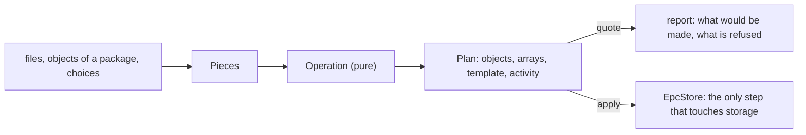

# Creating objects

Writing a valid EnergyML object by hand means assembling a uuid, references
(DORs), a CRS, HDF5 paths and activities. `energyml-build` is the layer that makes
writing usable: "wells from this CSV", "a surface from these points", "a map
interpolated from these samples". It has one principle.

> **An operation is a pure function from a bag of pieces to a plan. Only `apply`
> writes.**



## Why pure

`AnyOperation::plan` takes no store. It cannot read one, so it cannot depend on
one, and a test reaches it with values alone; what the caller knows of the
package arrives already resolved. This gives you, for free:

- **a quote before the invoice**: `--plan` shows the objects, uuids and arrays an
  operation would produce and writes nothing;
- **the same operation behind every face**: the command line, the Python bridge,
  a web page and Galaxy all call the registry; none of them contains a creation
  rule;
- **reproducible output**: uuids are derived (v5) from what the input owns - a
  file and its features, an EPSG code - so a second run over the same source names
  the same objects, and `--now` fixes the instant so the package is identical byte
  for byte.

## A refusal is a sentence

`Registry::offers(&pieces)` answers *what can I create with this?* and lists the
operations that do **not** fit **with their reason** ("a set of polylines is not
written as a triangulated surface"), because *absent* reads as *not written yet*.

## What an operation declares

| Declaration | Meaning |
|---|---|
| `needs()` | what it still asks the caller: a number (with unit and bounds), an integer, an EPSG code, a flag, a closed choice, text, a CRS, an object of the package... Each is a `Slot` rendered as a CLI option, an interactive question or a form field |
| `takes()` | the pieces it consumes: tables, features, a document, objects of the package |
| `gives()` | the roles of what it writes, with types and cardinality |
| `reports()` | what its activity records that is neither a choice nor an output |

The same declaration generates the command-line help, the web form, the
[Galaxy tool](galaxy.md) and the canonical `ActivityTemplate` of the operation.
Every run records an `Activity` against that template, so the form and the record
are one declaration.

## The operations

About ninety, grouped by what they do:

| Family | Examples |
|---|---|
| Foundations | crs, collection, representation sets, new version, edit, attach, media, colormap |
| Import | pointsets and polylines from GeoJSON, wells and properties from CSV/JSON tables (with OSDU column templates), WITSML wells and logs, terrain, GeoSciML GeologicUnit import (tested with SIGEOL exports) |
| Wells | well, well plan, blocked wellbore, computed tops, contacts |
| Surfaces | interpolate (IDW, kriging, MBA), triangulate, isocontours, surface maps (dip, curvature), remesh, densify, extend, clip, loft, outline, intersect, project, measure, thickness, zone statistics |
| Structural | fault, fault throw, horizon law, boundary, stratigraphy, structural organisation, earth model, cross section |
| Grids and properties | IJK grid, faulted grid, local grid, grid properties, sub-representation, time series |
| PRODML and WITSML | fluid sample, pressure transient analysis, injection test, product flow model |

Run `energyml create --list` for the list your build has, and
`energyml create --list --from your-file.geojson` for what a given input allows.

## Using it from the command line

```sh
energyml create crs --set epsg=2154 --set vertical=5720 --plan     # the quote
energyml create crs --set epsg=2154 --set vertical=5720 --out crs.epc
energyml create polylines --from model.epc#<uuid> --set title="Copy" --into model.epc --out model+copy.epc
energyml create interpolate --from model.epc#<uuid> --set method=idw --set spacing=100 --into model.epc --out model+map.epc
```

`--set name=value` is generic; `--list` shows what each parameter is, which it
depends on (*with*), which it excludes (*not with*), and what leaving it out
makes (*[empty: creates ...]*).

## Using it from Rust

```rust
use energyml_build::{apply, operation::Registry};

let registry = Registry::new();                       // the built-in operations
let offers = registry.offers(&pieces);                // what fits, with refusals named
let plan = registry.plan("crs", &pieces, &choices, &identity, &when)?;
// ... inspect `plan`, then, and only then:
let made = apply::apply(&plan, &mut store, &when);
```

A caller can also start from `Registry::bare()` and `register` operations of its
own; a registered operation is tried ahead of the built-ins.

## Recipes

A recipe is a versioned TOML file of ordered steps, each an operation with its
settings and its inputs. `energyml create --recipe` plays every step through the
same door into one package and writes it at the end. Played, the recipe is also a
workflow: an `ActivityTemplate` with one sub-activity per step, and a root
`Activity` that every step's activity names as its parent.

```sh
energyml create --recipe recipe.toml --plan               # what each step would make; writes nothing
energyml create --recipe recipe.toml --out Lutetia.epc    # the package, and Lutetia.h5 beside it
```

A sketch (TODO(verify): the key names below are those of the current parser and
are being translated to English; check them against the published version):

```toml
titre    = "Lutetia"                 # the package title
creation = "2026-09-24T00:00:00Z"    # stamped on every object: two runs, one package
auteur   = "Geosiris"                # every Citation's Originator
donnees  = "Lutetia.h5"              # the HDF5 file for steps that do not name another

[[etape]]
nom       = "repere"                 # unique: later steps refer to what this one wrote by it
operation = "crs"
set       = { epsg = 2154, vertical = 5720 }

[[etape]]
nom       = "sol"
operation = "interpolate"
entrees   = [ { creneau = "shape", etape = "repere", type = "PointSetRepresentation" } ]
set       = { spacing = 25.0, title = "Ground" }
```

An input refers to what an earlier step wrote **by that step's name** (narrowed
by `type`, `titre` or `role`), never by a uuid copied from a run. Everything is
checked before any step plays: unknown keys, unknown operations, duplicate step
names, settings the operation does not declare, inputs from a step that comes
later. A step marked as waiting is checked and reported, not played - never
commented out, which would leave nothing to report.

The reference model [`energyml-lutetia`](https://github.com/geosiris-technologies/energyml-lutetia)
is replayed from a recipe this way.

## Logging

Spans carry the elapsed time of each operation, recipe step, read and write; see
[Logging](logging.md).

## Writing your own

See the design notes in [ADR 0017](adr/0017-operation-is-a-pure-function.md). In
short: implement the operation trait with a `plan` that uses only its arguments,
declare `needs`, `takes`, `gives`, push it to a `Registry`, and the CLI, the
Python bridge and the Galaxy generator all find it.
