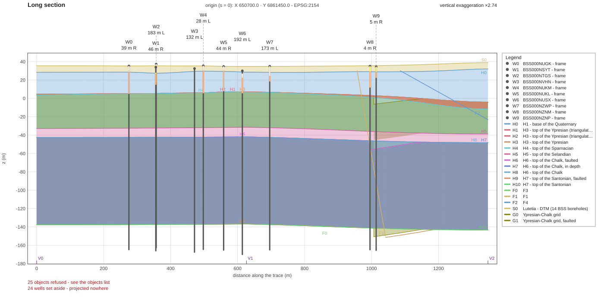
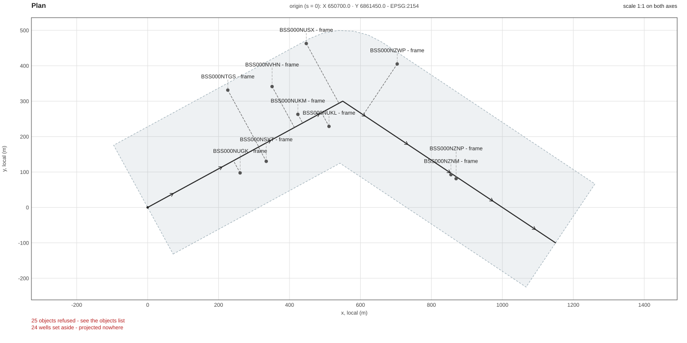
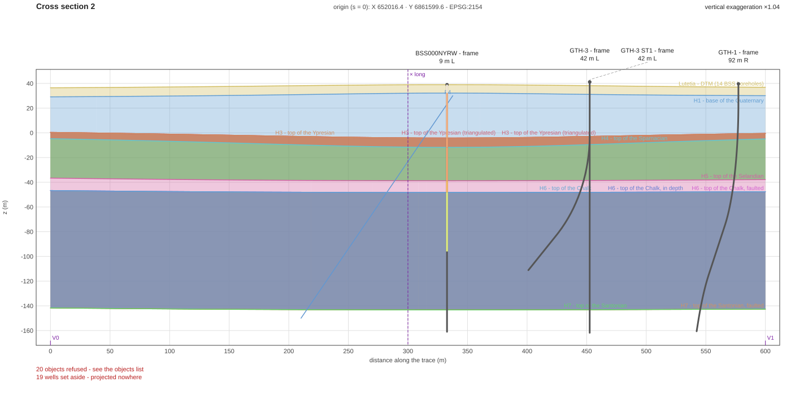
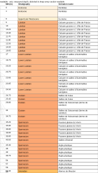
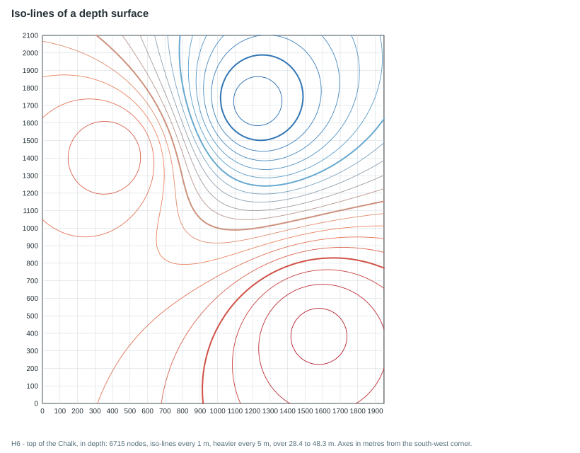
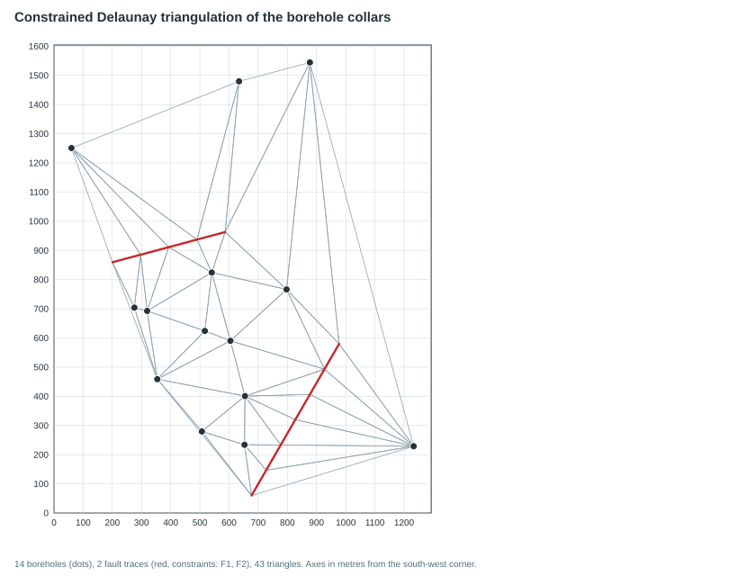
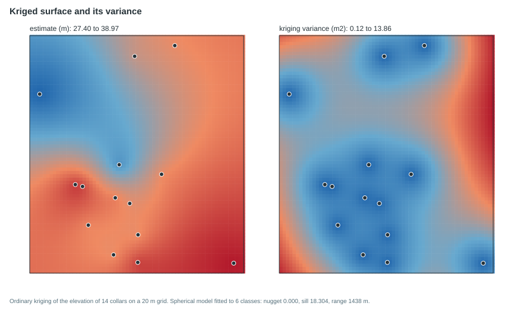

# Gallery

Every image in this repository is **reproducible**: it is drawn from the
reference model [`energyml-lutetia`](https://github.com/geosiris-technologies/energyml-lutetia),
at the commit pinned in [`tests/lutetia.lock`](../tests/lutetia.lock), by the command
written beside it. The SVG files are what the command writes, with nothing edited
by hand; the same package gives the same bytes.

The commands below run from the folder that holds `package/Lutetia.epc` (the `.h5`
beside it is found by name). The three sections use one track, so the three views
show the same ground.

| Image | What it shows | Produced by |
|---|---|---|
| `images/section-long.svg` | long profile along a track: wells, horizons, faults, strata fills | `energyml profile package/Lutetia.epc --track "650700,6861450;651250,6861750;651850,6861350" --left 200 --right 150 --static --size 1400x700 --draw long --fill down --labels codes --svg section-long.svg` |
| `images/section-plan.svg` | map view of the same section | the same command with `--draw plan` and `--svg section-plan.svg`, without `--fill` and `--labels` |
| `images/section-cross.svg` | a cross section, the second of three | the same command with `--cross-count 3 --cross-length 300 --cross-width 100 --draw cross:2 --fill down` and `--svg section-cross.svg`, without `--labels` |
| `images/well-sheet.svg` | well sheet of the wellbore whose columns show the most different colours (five, all of the Cenozoic stages): depth, stratigraphy, formation name | the `gallery` example below, `energyml_sheet::read::board_of_frame` then `layout::compute` and `svg::write` |
| `images/isocontours.svg` | iso-lines of the depth surface "H6 - top of the Chalk, in depth", every 1 m and heavier every 5 m | the `gallery` example, `energyml_geostat::isocontour` |
| `images/triangulation.svg` | constrained Delaunay triangulation of the 14 borehole collars, with the traces of faults F1 and F2 as constraints | the `gallery` example, `energyml_geostat::triangulate` |
| `images/kriging.svg` | ordinary kriging of the collars' elevation on a 20 m grid, the estimate and its variance side by side | the `gallery` example, `energyml_geostat::kriging` and `variogram` |

The four last images have no command-line subcommand, so one program draws them with
the libraries themselves, from the same pinned package:

```sh
cargo run -p energyml --example gallery --features all,hdf5 -- package/Lutetia.epc --out docs/images
cargo run -p energyml --example gallery --features all,hdf5 -- package/Lutetia.epc --out docs/images --check
```

The second line writes nothing and fails when a file under `docs/images/` differs from
what the code draws now. It is **not run by CI**: run it after changing a drawing
library, with Lutetia at the commit of `tests/lutetia.lock`. The drawing is a pure
function of the package: no clock, no random number, every number written with a fixed
width. Two runs give the same bytes, and a test in `energyml-geostat` pins the one
place where that once failed (the order in which `isocontour::chain` returns lines).

The long section and the cross section carry notes under their plot, as every
drawing does: how many objects were refused (a surface in time with no time factor,
for example) and how many wells fall outside the band. Nothing is hidden to make the
picture tidier.















The well sheet shows few colours because the package gives few: only the stratigraphy
column has any (the stage colours of the BRGM chart, all of them close oranges for the
Cenozoic), and no well of Lutetia shows more than five. The formation and lithology
columns carry text only, since the file states no colour for them and the library does
not invent one.

The well sheet is drawn in the `readable` proportion mode: the depth axis is distorted so
that every interval is tall enough to read, which the sheet says in its own header. At
the very bottom the last depth label overlaps the one above it; that is the layout of
`energyml-sheet` as it stands, left visible rather than hidden.

Screenshots of interactive applications are not part of this repository.
