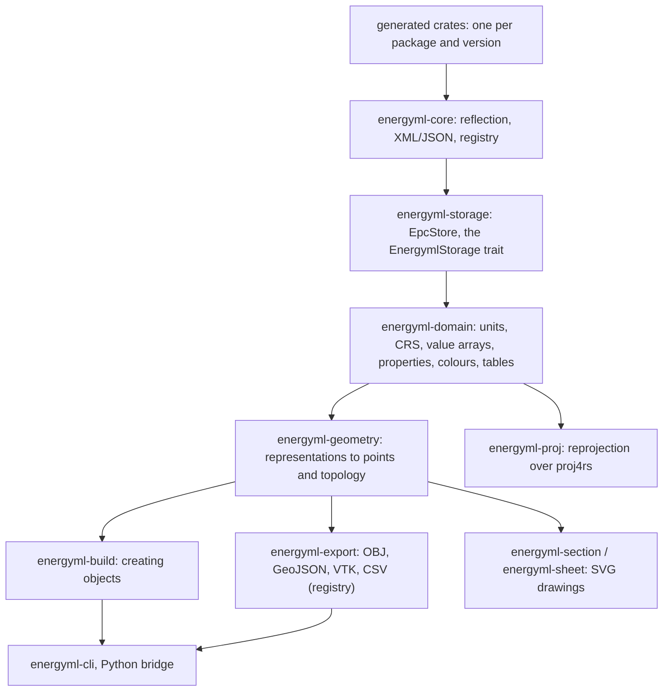

# The library

Reading, editing and writing EnergyML packages from Rust: objects, value arrays,
geometry, coordinate systems, exports. The command line and the Python bridge
are thin faces over exactly what is described here.

An application that wants all of it takes **one dependency**, `energyml`, which
re-exports the crates below under short module names (`energyml::storage`,
`energyml::geometry`, …); one that wants a single layer depends on that crate
directly.

## The layers



- **`energyml-core`** has no knowledge of any schema and no native dependency
  (it builds for WebAssembly). It holds the reflection traits, the XML reader
  and writer, the JSON encoding and the type `Registry`.
- **`energyml-schemas`** registers every generated version in one place; the
  storage layer receives a registry and never builds one.
- **`energyml-storage`** reads and writes EPC packages behind the
  `EnergymlStorage` trait.
- **`energyml-domain`** holds what does not change between versions: units, CRS,
  value arrays in every shape, statistics, property kinds, colours, lookup tables.
- **`energyml-geometry`** turns representations into points and topology.

## Choosing versions

The generated crates are heavy, and most applications read one release. Each
schema version is therefore a Cargo feature of `energyml-schemas`, relayed by
`energyml`, spelled as Energistics spells a qualified type:

```toml
# RESQML 2.2 and the EML 2.3 it is built on. No 2.0.1, no WITSML, no PRODML.
energyml = { version = "0.1", features = ["resqml22"] }
```

`eml20` … `eml23`, `resqml20` (the 2.0.1 crate), `resqml22`, `resqml22dev3`,
`witsml20`, `witsml21`, `prodml20`, `prodml22`, `prodml23`; the families `eml`,
`resqml`, `witsml`, `prodml`; and `all`. A version feature brings the EML
version its crate is built on, so `resqml22` brings `eml23` and `resqml20`
brings `eml20`. The `energyml` facade turns nothing on by itself;
`energyml-schemas` keeps `default = ["all"]` for the tools that want everything.
`energyml::build` and `energyml::providers` are features too, and `build`
turns on the four versions it writes (RESQML 2.2, EML 2.3, WITSML 2.1,
PRODML 2.3).

Whatever the spelling in a document - `2.0`, `2.0.1`, `resqml20.` or
`resqml201.` - RESQML 2.0.1 is read by the one `resqml20` feature; the trailing
`1` is not needed. A version that is not compiled is a **named refusal**, never
a half read: `energyml::schemas::missing_feature("resqml", "2.2")` says "RESQML
2.2 is not compiled in: enable the `resqml22` feature of energyml-schemas (or of
energyml)".

## Reading an object

```rust
use energyml_core::prelude::*;
use energyml_core::{path, registry};
use energyml_resqml_2_2 as resqml;

let mut reg = registry::Registry::new();
resqml::register(&mut reg);
energyml_eml_2_3::register(&mut reg);

// You know the content type (an EPC gives you one per part).
let object = reg.read_xml(
    "application/x-resqml+xml;version=2.2;type=TriangulatedSetRepresentation",
    bytes,
)?;

// Reach into it without knowing its type...
let title = path::get_string(object.as_reflect(), "Citation.Title")?;

// ...or downcast to the concrete one.
let repr = object.as_reflect().downcast_ref::<resqml::TriangulatedSetRepresentation>();
```

## Opening a package

```rust
use std::sync::Arc;
use energyml::storage::EpcStore;

// `energyml::schemas::all()` registers the versions whose feature is on
// (see "Choosing versions": `features = ["all"]`, or the ones you read).
let store = EpcStore::open("model.epc", Arc::new(energyml::schemas::all()))?;

for summary in store.resources() {                // no object XML is opened
    let header = store.header(&summary.uri)?;     // stops at the end of the citation
    println!("{} - {}", summary.qualified_type, header.display_name());
}

for diagnostic in store.diagnostics() {           // what the package gets wrong
    eprintln!("{diagnostic}");
}
```

An object whose uuid is the nil UUID (`00000000-0000-0000-0000-000000000000`)
is read and listed as usual, and gets a warning in those diagnostics, whether it
is a part or held by value in another object: it identifies no instance
(RFC 4122 section 4.1.7; Energistics Identifier Specification v5.0, section
2.3.1). `energyml check` shows it in its package section.

Reference checking is a free function over objects in memory, so a client that
does not hold an EPC can reuse it:

```rust
let issues = graph::check_references(&summary, object.as_reflect(), &|uuid| store.find_by_uuid(uuid));
```

The Energistics JSON encoding goes both ways:

```rust
let text = energyml_core::json::write_string(object.as_reflect(), true)?;
let document = energyml_core::json::read_string(&text, &registry)?;
```

### Finding an object: one door

An object is found by `EpcStore::lookup`. A bare uuid is accepted at the edge of
the library (`lookup_uuid`, `resolve`) and is turned at once into a full
identity; internally everything is keyed on the full URI, version included. See
[ADR 0003](adr/0003-identity-full-uri-one-door.md).

### An EPC as a named dataspace

`EpcStore::open` makes the file the default dataspace: every URI is
`eml:///<type>(<uuid>)`. A server that serves several EPCs at once (a folder of
them, each a dataspace named after its file) needs the dataspace in the URI, or
two distinct objects of two packages would share one:

```rust
let store = EpcStore::open_in_dataspace("Lutetia.epc", registry, "Lutetia")?;
// eml:///dataspace('Lutetia')/resqml22.BoundaryFeature(<uuid>)
assert_eq!(store.dataspace().uri, "eml:///dataspace('Lutetia')");
```

`EpcStore::from_reader_in_dataspace` does the same for bytes in memory. The name
is an ETP dataspace path (`Lutetia`, `projets/demo`); one the URI grammar refuses
is an `Error::BadUri`. Every URI the store builds then carries the dataspace, and
the identity is the full URI: a URI of another dataspace, or without one, is
`Error::NotFound` (a bare uuid is still accepted at the edge and answers the full
URI). A reference names no dataspace and resolves inside the dataspace of the
object that writes it, so the target of `references()`, `edges()` and `graph()`
is spelled in its source's. `open` and `from_reader` are unchanged.

### Reading policy

Strict is the default. `ReadMode::Lenient` (CLI: `--lenient`) tolerates missing
required elements and reports one diagnostic per invention. Parts no parser can
read are listed by `energyml repair`. See [ADR 0004](adr/0004-reading-policy.md).

## Editing and saving

```rust
use energyml_storage::SaveOptions;

let mut store = EpcStore::open("model.epc", Arc::new(registry))?;
energyml_core::path::set(
    store.edit(&uri)?,                    // marks the object modified
    "Citation.Title",
    energyml_core::value::OwnedValue::Str("Renamed".into()),
)?;
store.remove(&other_uri)?;
store.save(&SaveOptions::default())?;     // atomic: temp file, then rename
```

Nothing touches the archive until the save, and the save **rebuilds** the
package: `[Content_Types].xml`, every `.rels` file in both directions and
`docProps/core.xml`. A description that no longer matches the contents is worse
than none.

## Value arrays

An object does not contain its numbers: it names a file and a path inside it.
Reading arrays needs the optional `hdf5` feature.

```rust
for location in store.arrays_of(object.as_reflect()) {
    let data = store.read_array(&location)?;   // one copy, into a typed Vec
    if let Some(points) = data.f64() {         // borrowed: no copy, no conversion
        draw(points);
    }
}

// Or straight into memory you already own:
let shape = store.array_metadata(&location)?;
let mut vertices = vec![0.0f64; shape.dimensions.iter().product::<i64>() as usize];
store.read_array_into(&location, &mut ArrayBuffer::F64(&mut vertices))?;
```

Writing is two calls on purpose, because they fail for unrelated reasons:

```rust
store.write_array_to("model.h5", "/resqml22/<uuid>/points", &data)?;
store.stamp_external_file("model.h5", proxy_uuid)?;     // the root `uuid` attribute
store.register_external_file(proxy_uuid, "model.h5");   // so `save` names it
```

`ArrayBackend` is the seam: HDF5 is one implementation, and a WebAssembly
application supplies its own without changing anything else. The MIME type of
an array picks the backend. Without a suitable one, only the array read fails,
and it says which capability is missing (`FeatureNotEnabled`) rather than
returning an empty array.

### Any array, whatever form it takes

An EnergyML value array is a choice of about twenty concrete types, and only a
third of them touch a file; the rest are constants, ranges, lattices, inline
values or derived from other arrays. `energyml_domain::values` resolves all of
them:

```rust
use energyml_domain::values;

let values = values::read(array, &store, "Values")?;   // whatever form it is
values.integer();     // Some(&[i64]) if that is the family
values.boolean();
```

`read` widens to one type per family; `read_native` keeps the file's own type;
`read_into` allocates nothing.

**Strings.** A string dataset in HDF5 (fixed or variable length, ASCII or UTF-8)
is read as `ArrayValues::Text`, and `values::read` widens it to `Values::Text`.
An empty string is a value, not a gap. A backend that does not decode strings
makes the column refuse by its name; it never answers an empty column or numbers
in place of text (`ArrayValues::Text` has no bytes to lend, and `as_bytes` answers
an empty slice). The HDF5 backend reads fixed-length strings up to 1024 bytes and
refuses longer ones by name; it does not write strings.

**Tables.** A table column that declares `ValueCountPerRow` greater than 1 reads
its values per row: `Rows::per_row` says how many, `Rows::values_of(row, column)`
gives the values of one row and `Rows::row_values(row)` those of a whole row.
`Rows::cell` answers only for a scalar column, and says `None` for the others
instead of a value that belongs to another row. The keys of a `DoubleTableLookup`
keep their fractional part (`Values::Floating`); those of a `StringTableLookup`
stay integers.

**Facets.** A property or a table column carries qualifiers, read by one function
whatever the release: RESQML 2.0.1 writes the kind in `Facet` and the value in
`Value`, EML 2.3 and RESQML 2.2 write the kind in `Kind` and the value in `Facet`.
`Facet.value` is a `FacetValue`, `Standard` when the schema lists it and
`Extension` when it is the producer's own
([ADR 0024](adr/0024-facets-read-in-every-version.md)).

**Reading a block.** `values::read_block` reads a block of an array by its
**stored** dimensions (`start` and `count` per dimension) and not the rest; a
source that hands back a different number of values than the block holds is
refused by name. `values::element_block` and `values::slab_block` compute the
block for elements, or for some slabs of the slowest free dimension (a time step
of a series, one realization), from the shape of the property: they are the one
block arithmetic, and the description of a property by slabs
(`property::chunks::PropertyChunks`) reads through them. The page
[The shape of a property](property-shape.md) gives the shape, the choice of a
component and the description of a property.

## From a representation to something you can draw

```rust
use energyml_geometry::{crs, geometry};

let surface = store.get_object(&uri)?;
let shape = geometry::of(surface.as_reflect(), &store)?;   // patches of points
let (vertices, indices) = shape.merged();                  // one buffer of each

if let Some(crs) = crs::of(surface.as_reflect(), &store)? {
    let placed = crs.project_all(&vertices);               // local -> projected
}
```

An EnergyML point array is not a file offset: of five concrete point-array
forms only one means "read the HDF5"; a lattice carries an origin and spacings
and its points are computed. Every form is resolved, including parametric and
borrowed-from-another-representation arrays; a form that a representation still
cannot take is refused **by name** instead of returning nothing. Supported:
triangulated and polyline sets, point sets, 2D grids, IJK grids (faults, K gaps,
parametric pillars, local grids), unstructured grids, wellbore trajectories and
frames, sub-representations.

Readers are a registry (`energyml_geometry::Readers`) keyed on the
version-independent concept name, so a new release that keeps a concept needs no
new reader.

## Directional surveys

A survey is read in `energyml_geometry::stations`, for a WITSML 2.1 `Trajectory` and for a RESQML 2.0.1
`DeviationSurveyRepresentation`, in four steps that each answer on their own.

- **Read**: `stations_of` lists the stations of the file, the values it declares at them (`Tvd`, `DispNs`, `DispEw`,
  `VertSect`, `Dls`) and the vertical section it declares (`AziVertSect` and its origin), and places nothing.
- **Judge**: `diagnose` runs ten checks in a written order and reports each as passed, failed with a typed `Finding`, or
  not reached. `read` replays the same steps and stops at the first failure with the same sentences.
- **Place**: `read_declaring` places the survey from its datum. A convention the file does not state is a parameter of
  the call (`SurveyDeclarations`): the north when `AziRef` is absent, and whether rejected stations are left out. The
  result carries where its north came from (`NorthSource`: stated, corrected from the file's convergence and
  declination, declared, or not needed) and the stations it kept. `survey_path` gives the line between the stations as a
  `PlacedPath`. The points are in the units of the CRS the object is in.
- **Compare**: `energyml_analysis::survey_qc` works on a read survey. `SignificanceCriterion` says whether an azimuth
  carries information, `SectionAzimuth` gives the azimuth of the vertical section, `compare` sets a survey against another
  path, `rotation_fit` fits the rotation between two surveys of one well, `stated_against_computed` compares the values the
  file declares with those recomputed, and `pairings` pairs the surveys of a well.

```rust
use energyml_geometry::stations;

let diagnosis = stations::diagnose(&survey, &store, &declarations);
for (check, finding) in diagnosis.failures() {
    println!("{check:?}: {finding:?}");
}
```

The choices the registry makes for a survey are in [House rules](house-rules.md) and
[ADR 0034](adr/0034-survey-north-and-stations.md).

## One CRS, whichever version wrote it

A coordinate system is one object in RESQML 2.0.1 and three joined by references
in EML 2.3. One reader covers both:

```rust
let crs = crs::of(surface.as_reflect(), &store)?.unwrap();
crs.projected.epsg();                 // Some(23031)
let placed = crs.to_metres(point)?;   // placed, and in metres
```

`to_projected` applies the local placement (rotation, offset, depth/elevation
flip). `to_metres` also normalises units. Units convert on the string the file
contains, never on a generated Rust variant (`LengthUom::Mm` meant the megametre
in one release and the millimetre in another). A unit outside the table is an
error, not an assumption. Resistivity, conductivity and angle per length (dogleg
severity) convert too; see
[Statistics, scales and measured depth](statistics-and-depth.md).

`crs.axes` says what the file states about the order of the two horizontal axes
of the placed frame (`Stated`, `NotStated`, `Unusable` or `Contradictory`; it never
guesses, and a missing statement never stops a point from being placed). Whether
that frame is direct or indirect decides which side is right around a well.
`direction_to_projected` is the door for vectors as `to_projected` is for points:
the same rotation and vertical flip, without the offset. See
[Around the well](around-the-well.md).

Reprojection goes through the `reproject::Reprojector` trait; `energyml-proj`
is the shipped implementation, pure Rust over `proj4rs` (so it builds for
WebAssembly). It refuses a definition that carries no datum rather than applying
one silently.

## Writing it out, and adding a format

```rust
use energyml_export::{Exporters, Options};
use energyml_geometry::scene;

let object = scene::object_of(surface.as_reflect(), &store, &uri)?;
let mut exporters = Exporters::builtin();
exporters.push(Box::new(MyVtkExporter));      // tried before the built-ins
exporters.get("vtk")?.write(&object, &mut file, &Options::new())?;
```

Built-in formats: OBJ, GeoJSON (always WGS 84, as RFC 7946 defines it), CSV, and
three VTK flavours (legacy, XML PolyData, XML UnstructuredGrid). A `SceneObject`
carries the shape, the CRS and the identity chain (uuid, URI, title, and the
interpretation and feature above it).

### Metadata is a file, not a code change

What an export carries beyond geometry is a JSON map of key to dotted path, and a
path crosses references transparently:

```json
{
  "title":        "Citation.Title",
  "contentType":  "contentType",
  "featureTitle": "RepresentedInterpretation.InterpretedFeature.Citation.Title"
}
```

The same keys come out as GeoJSON `properties`, VTK `FieldData` and OBJ
comments. A path that finds nothing yields no key; a key that matched nowhere in
the whole package is reported.

## The storage trait

`EpcStore` implements `EnergymlStorage`, a trait drawn after the ETP protocol.
The ETP client lives in a separate repository,
[`retp`](https://github.com/geosiris-technologies/retp), and implements the same
trait for a remote dataspace: an application written against the trait changes
transport by changing the line that builds the store.

The objects a part holds by value (a WITSML `Channel` in a `Log`) are data
objects of their own: `resources()` lists the parts, `contents()` the contained
objects with their edge to the container, and `references()` gives a reference
written inside a contained object to that object ([ADR-0023](adr/0023-objects-held-by-value.md)).

## Further reading

[Creating objects](creating-objects.md) · [Geostatistics](geostat.md) ·
[Schemas](schemas.md) · [House rules](house-rules.md)
