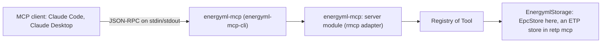

# The MCP server

[MCP](https://modelcontextprotocol.io) (the Model Context Protocol) lets a language
model call tools that a program offers. `energyml-mcp` is such a program for an
EnergyML package: you register it in Claude Code, Claude Desktop or another MCP
client, and the model can orient itself in an EPC file, list and find objects, read
one as JSON, follow its references and read a bounded window of an array.

It is **read-only**. No tool writes, and the package is opened without any way to
save it. It is also a **face** like the command line (ADR-0012): the tools call the
storage traits and the library, and hold no EnergyML logic of their own.



## Installing and running

```sh
cargo install energyml-mcp-cli       # installs the `energyml-mcp` program
energyml-mcp model.epc               # waits for a client on stdin: not meant for a terminal
energyml mcp model.epc               # the same, through the `energyml` command
energyml-mcp model.epc --h5 data.h5  # offer an HDF5 file for the arrays
```

`energyml mcp` works because the `energyml` command runs `energyml-<word>` when it
does not know a word (see [The command line](cli.md)); the program is a package of
its own so that the MCP SDK and its async runtime stay out of the `energyml`
binary, its Docker image and the Python wheels.

Reading **array values** needs a build with the `hdf5` feature (`cargo install
energyml-mcp-cli --features hdf5`). Without it the arrays are listed as unreadable
and `energyml_read_array_window` refuses with `feature_not_enabled`: the data is
not absent, the means to read it is.

## Registering it in a client

### Claude Code

```sh
claude mcp add energyml -- energyml-mcp /path/to/model.epc
claude mcp add energyml-wells -- energyml-mcp /path/to/wells.epc --h5 /path/to/wells.h5
```

One server per package: add it once for each file you want the model to see. Claude
Code starts the program itself and talks to it over its stdin and stdout.

### Claude Desktop

Add the program to the `mcpServers` object of the configuration file, then restart
the application:

```json
{
  "mcpServers": {
    "energyml": {
      "command": "energyml-mcp",
      "args": ["/path/to/model.epc"]
    }
  }
}
```

On Windows, write the path of the package with forward slashes or doubled
backslashes (`"C:\\data\\model.epc"`), and give the full path of `energyml-mcp.exe`
as `command` if it is not on the `PATH` the application sees. The file is
`claude_desktop_config.json` in `%APPDATA%\Claude` on Windows and in
`~/Library/Application Support/Claude` on macOS. TODO(verify): the locations come
from the client's own documentation, not from a test here.

A limit can be given as an argument in `args` (`"--timeout-seconds", "60"`) or as
an `ENERGYML_MCP_*` variable in an `env` object. A configuration file is readable by
anyone on the machine: put no secret in it.

### For an ETP server

`retp mcp wss://...` serves **the same tools** over an ETP server instead of a file
(the connection options and the credentials, passed by environment variables, are
those of `retp`). It is part of the [`retp`](https://github.com/geosiris-technologies/retp)
project, which depends on this library and not the other way round. The tool names,
arguments, limits and refusals described here are the same.

## The tools

All are read-only. Names carry the `energyml_` prefix so that a client which joins
several servers does not see two `list_resources`.

| Tool | What it does | Calls |
|---|---|---|
| `energyml_store_info` | Kind of store, capabilities, dataspace and type counts, whether arrays are readable, diagnostics, the limits in force. Call it first | `store_kind`, `capabilities`, `dataspaces`, `supported_types`, `diagnostics` |
| `energyml_list_dataspaces` | The dataspaces with their URIs (an EPC file is exactly one). `custom_data`: keys only unless the operator shows values | `dataspaces` |
| `energyml_list_resources` | The objects of a dataspace, or those reachable from an object, with type and URI. `types`: exact or `family.*`, case sensitive | `resources_in` |
| `energyml_find_resources` | Case-insensitive substring search: `title_contains`, `type_contains` (not the same as `types` above), `uuid_prefix` | `search::find`, `headers` |
| `energyml_describe_object` | One object as EnergyML JSON (`$type` on every object), bounded; XML when the store lists it, refused by name otherwise | `get_object`, `header`, `references`, `get_raw` |
| `energyml_get_references` | Targets, sources or both up to a depth; references to absent objects are reported as `dangling`. Each edge carries its `kind` (primary, secondary) when the store states it, and `kind_basis` when that kind is derived rather than given by the specification (ADR-0022); `edge_kind_coverage` names the MLs it is stated for | `resources_in`, `references`, `resources` |
| `energyml_list_arrays` | The arrays an object points at, with shape and element type, no values; an unreadable array is listed with the reason | `get_object`, `arrays_of`, `array_metadata` |
| `energyml_read_array_window` | A bounded window of one array, with statistics and a preview; never the whole array | `array_metadata`, `window::read_window` |

`tools/list` shows them in this order. Every `uri` argument goes through the one
door that parses ETP URIs; a bare `uuid` is accepted at the entry of
`energyml_describe_object` and `energyml_list_arrays` only, and turned at once into a
full URI (an ambiguous one is refused with the candidates). Everything the tools
return carries full URIs, which the model copies into the next call.

Every answer is bounded and says so: it carries `truncated` and, when true,
`truncation { reason, limit, how_to_get_more }`; every list carries `total`,
`returned` and `next_cursor`. Tool answers are sent twice, as the specification
asks: as structured content and as the same JSON in a text block.

The tool hints (`readOnlyHint`, `openWorldHint`, title) are only hints: an EPC is a
closed world, an ETP server an open one. Nothing is protected by a hint; the
program simply has no tool that writes.

## Limits

Settings of whoever runs the server, never of a tool call. A call argument can
**lower** a bound and never raise it.

| Limit | Option | Default | Role |
|---|---|---|---|
| `max_response_bytes` | `--max-response-bytes` | 65 536 | hard bound of any answer; a larger one is refused `too_large`, lists stop earlier and say so |
| `max_list` | `--max-list` | 500 | ceiling of every `limit` argument |
| `max_header_scan` | `--max-header-scan` | 2 000 | headers a title search reads when nothing narrows it |
| `max_window_elements` | `--max-window-elements` | 10 000 | elements one array window returns |
| `max_object_bytes` | `--max-object-bytes` | 262 144 | ceiling of `max_bytes` of `energyml_describe_object` |
| `call_timeout` | `--timeout-seconds` | 30 s | time one call may take |

Each option has an `ENERGYML_MCP_<NAME>` variable (`ENERGYML_MCP_MAX_LIST`, ...,
`ENERGYML_MCP_TIMEOUT_SECONDS`); the command line wins. The program refuses a value
outside a sensible range at start-up (see its README). `energyml_store_info` reports
the limits in force.

**The timeout.** Each call runs on a blocking thread, because a store may block
inside its `async` methods (an ETP round trip, a file read), and is raced against
the timeout. A call that is too slow is answered with a `timeout` refusal at the
timeout. The thread cannot be cancelled: it ends on its own and its answer is
dropped.

## Refusals

A tool that cannot answer returns a refusal, never an empty list: a tool result
with `isError: true` and `{"refusal": {"code", "message", "store"?, "operation"?,
"hint"?, "detail"?, "candidates"?}}` as structured content (and as text). The model
can read it and correct itself.

| Code | Meaning |
|---|---|
| `not_found` | no such object, dataspace or array; list first |
| `ambiguous` | an identifier names several objects; `candidates` has their full URIs |
| `bad_uri` | not a URI this store can use |
| `unsupported` | the store does not offer this operation; do not retry |
| `feature_not_enabled` | a capability is missing (HDF5 not compiled in): the data is not absent |
| `external_data` | the data lives in a file or path that cannot be reached |
| `too_large` | the answer would exceed a bound; narrow the request |
| `remote` | the remote server failed or refused; retry later |
| `bad_arguments` | an argument is missing, unknown, ill-typed or out of range |
| `timeout` | the call took longer than the server allows |
| `other` | anything else |

Only an unknown tool name is a JSON-RPC protocol error (code -32602); it is the one
failure the model cannot act on.

## Untrusted data

Titles, descriptions, server messages and custom data come from the package and may
contain instructions aimed at the model ("ignore previous instructions..."). The
tools return them only inside **data fields** (`title`, `detail`, `candidates`...),
as the whole value of the field, never inside a sentence written by the server. The
description of every tool, and the instructions sent at `initialize`, tell the model
that these fields are data and not instructions. Credentials that a remote server
echoes in an error are removed from `detail`.

None of this makes a package trustworthy: a model that reads a package it did not
write is reading input from someone else. Treat the output of the tools as you would
a document you were sent.

## Standard output is the protocol

The program writes only JSON-RPC messages on stdout. Its start-up line and its errors
go to stderr, and a failure to start (a missing file, a bad option) leaves stdout
empty with a non-zero exit status. Clients show stderr in their logs.

## Adding tools (for applications)

An application that embeds the library can offer its own tools next to these:

```rust
use std::sync::Arc;
use energyml_mcp::server::{Server, ServerIdentity};
use energyml_mcp::{Extensions, FixedStore, Limits, Registry};

let registry = Registry::builtin().with_tool(Box::new(MyTool));
let extensions = Extensions::new().with(MyAppHandle::new());
Server::new(registry, Arc::new(FixedStore::new(store)), Limits::default(),
            ServerIdentity::new("my-app", "1.0"))
    .with_extensions(extensions)
    .serve_stdio()?;
```

- **`Registry::with_tool`** adds a tool. Caller tools are listed first and tried first;
  one with the name of a builtin tool **shadows** it (the name is listed once and the
  caller's tool answers).
- **`ToolContext::extensions`** carries what the tool needs beyond the store (an
  application handle, the account of an HTTP request). The builtin tools never read it.
  A tool whose extension is missing should refuse with a named refusal, not panic.
- A tool is a value implementing `energyml_mcp::Tool`: name, title, description, input
  schema (`additionalProperties: false`), and an `async call` that answers a
  `ToolOutput` or a `Refusal`. Its description must say that the contents of the
  fields of its answer are data.

The `Tool` trait and the registry do not mention any MCP SDK: the SDK (`rmcp`) is an
adapter behind the `server` feature of `energyml-mcp`, off by default, so that a
program that only wants the registry has no async runtime. See
[ADR 0021](adr/0021-own-tool-trait-rmcp-as-adapter.md).

## Compatibility

The contract with clients is the tool names and their arguments. A tool name never
disappears or changes meaning; an argument added later is optional; a field added to
an answer does not remove an old one; an incompatible change is a new tool name and
the old one is deprecated. A test keeps a snapshot of `tools/list` and fails when one
of these moves without being written down.

The server answers both generations of the protocol (the `initialize` handshake and
the stateless `server/discover` of the 2026-07-28 revision); that is the SDK's job.
