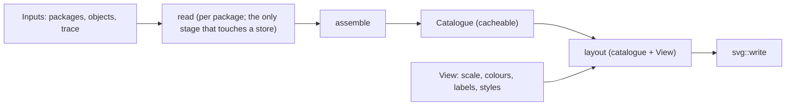

# Section view

Long profiles and cross sections of a model along a trace: wells projected onto
the section, surfaces and IJK grids cut by it, strata colours, markers, a legend,
and an SVG you can open in a browser or edit in Inkscape. The computation is in
Rust (crate `energyml-section`); the drawing is the same one whatever asks
for it - the command line, a library call, or an application.

> Images: TODO - produced from the reference model by
> `cargo run --example gallery`, see [Gallery](gallery.md).

## From the command line

```sh
# A long profile along a track (GeoJSON LineString, or "x,y;x,y;..." inline)
energyml profile package/Lutetia.epc --track track.geojson --left 300 --right 300 --svg long.svg

# A map view of the same section
energyml profile package/Lutetia.epc --track track.geojson --left 300 --right 300 --draw plan --svg plan.svg

# Cross sections every 300 m along the track; draw the second one
energyml profile package/Lutetia.epc --track track.geojson --left 300 --right 300 \
  --cross-every 300 --cross-length 400 --cross-width 150 --draw cross:2 --svg cross-2.svg

# PNG (build with the png feature), short codes plus a legend instead of full titles
energyml profile package/Lutetia.epc --track track.geojson --left 300 --right 300 \
  --labels codes --svg long.svg --png long.png --png-scale 2

# Several packages in one section: the first is s1, each --also the next
energyml profile model.epc --also wells.epc --also faults.epc --track track.geojson \
  --left 300 --right 300 --svg long.svg

# Redraw a drawing from its own metadata (same packages: same bytes)
energyml profile model.epc --from-svg long.svg --svg again.svg
```

Without `--svg`, `profile` answers a plainer question: which wells have their head
in the band around the track, how far along it, how far off it, and on which side
(`--json` for the full answer, including the band as a polygon).

Wells are all trajectories and frames of all packages (or the `--well`s); surfaces
are all triangulated sets, 2D grids and IJK grids a section cuts (or the
`--surface`s). A frame and the trajectory of the same wellbore are one line, the
frame that states the strata kept.

## How it is built



Three stages, three costs:

1. `read` reads one package's wells, surfaces and grids, reprojects them into the
   scene's system and cuts them along every section trace.
2. `assemble` joins the contributions of every package into a `Catalogue`: wells
   projected on each section, frames and trajectories of one wellbore folded into
   one line, and the fate of every object.
3. `layout` turns a catalogue and a `View` into numbers (scales, ticks, fills,
   labels); `svg::write` writes them. Nothing is read or recomputed here.

Changing the **view** never rebuilds a catalogue; changing the **inputs** does.
`model.rs` holds the types every stage is written against; they travel as JSON
(camelCase), including in the SVG's metadata. Callers use `compute` and `draw`,
not the stages one by one, so there is **one drawer**: what is exported is what
was shown. The crate has no native dependency and compiles to WebAssembly.

## Rules the drawing follows

- **Every refusal is a line**, in English, naming the object. An object that cuts
  nothing is *missed*, not refused.
- **Nothing that is not a number leaves a contribution.** A well without an
  elevation or with fewer than two finite nodes is refused by name; a surface cut
  is broken at a hole, never joined across it.
- **Fills go to the next horizon, abscissa by abscissa.** For each trace, the
  nearest surface strictly above or below at each position bounds the polygon;
  where there is none, nothing is filled (no floor is invented). A fault never
  bounds a unit and is never filled. Two surfaces interpreting the same feature
  are one horizon drawn twice and do not fill toward each other.
- **Grids are cut as envelopes**: roof and floor stacked by column, a fault as a
  vertical step, a K gap as a hole.
- **The section checks itself.** Where two cut surfaces cross, both must give the
  same elevation; otherwise a `crossingMismatch` note with both values (tolerance
  0.5% of the vertical extent, at least one centimetre). Younger horizons passing
  under older ones are marked as erosions, but only when ages are stated in the
  model: no age is ever inferred.
- **Marks do not overlap.** Labels are placed level by level, full text then
  short form; a mark without room keeps its line, loses its text, and the count
  is reported.
- **The SVG is safe to embed.** Colours are attributes, all text is escaped (a
  package title is someone else's text), and each object is a `<g>` carrying
  `data-store` and `data-uri`. Legends are separate groups marked as Inkscape
  layers so they can be edited. The SVG zooms itself in a browser (strokes keep
  their width, points and text keep their size); `--static` turns that off.

## Options of the view

- **Strata legend** (`--strata-legend`): one entry per unit and colour.
- **Portions without strata** (`--unstratified hidden|solid|dashed|hatched`, with
  parameters such as `dashed:colour=#999999,dash=6,gap=4`): the library declares
  the available styles and their parameters, so an interface builds its form from
  that list instead of spelling them.
- **Markers** (`--marker NAME:shape=...,colour=...,at=...`): a named marker on a
  set of objects chosen by `type=` and `title=`, with a legend. Shapes are read
  from the model (the `Symbol` enumeration of `GraphicalInformationForNodes`);
  a value the drawer cannot draw is refused by name, never replaced by a circle.
- **Vertical exaggeration** is written on the drawing.

## From Rust

```rust
use energyml_section::{compute_packages, draw};
// inputs: the packages, what to cut, the trace; view: how to draw it
let catalogue = compute_packages(/* inputs, opened packages */)?;
let svg: String = draw(&catalogue, &view);
```

TODO(verify): exact signatures of `compute`, `compute_packages`, `redraw` and
`draw` in `crates/energyml-section/src/lib.rs` before publishing; the
example above is a sketch of the call shape.

See also [Well sheet](well-sheet.md) and
[ADR 0015](adr/0015-section-view.md).
