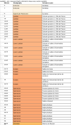

# Well sheet

A two-dimensional sheet of one well - depth column, stratigraphy, interval
properties laid out as tracks - computed in Rust and written as SVG, in the style
of borehole logs published by geological surveys. The crate is `energyml-sheet`.

A sheet of a Lutetia borehole, drawn by the library (the command is in the
[Gallery](gallery.md)):



## Status

| Part | State |
|---|---|
| layout (`layout::compute`), text measurement (`text::wrap`) | done, tested in numbers |
| SVG output (`svg::write`) | done |
| reading a wellbore frame into a board (`read::board_of_frame`) | done |
| curves for per-node properties and channels | not started |
| PNG / PDF output | not started (they will be derived from the SVG, never drawn separately) |
| lithology patterns | study done, not coded; licences of pattern catalogues must be checked before any is bundled |
| command-line subcommand | not started (TODO(verify)) |

## The model of a sheet

A sheet is an **ordered list of tracks**, each a *source* and a *rendering*.

| Source (where values along the measured depth come from) | Example |
|---|---|
| measured depth | the depth column |
| strata of a rank | chronostratigraphy, formation |
| interval property (categorical with its lookup table, discrete, continuous) | lithology by interval |
| per-node property, WITSML channel | temperature log (planned) |
| markers | picked boundaries (planned) |

| Rendering | For |
|---|---|
| flat fill with the model's colour | strata, categories that carry a colour |
| wrapped text | labels, descriptions, values |
| curve with its scale in the header | per-node properties (planned) |
| graduation | measured depth |

Sources and renderings are held in registries, not `match` statements, so a
caller can add its own.

## Layout rules

- **Only interval tracks cut the sheet.** Sections are the union of the bounds of
  the displayed interval tracks. A log with tens of thousands of stations never
  creates tens of thousands of sections.
- **A gap is stated, never filled**: an interval without a value is a visible
  blank. Two sources of strata that contradict each other on one well make two
  tracks, never a merge. Two frames with different datums are refused, naming
  both.
- **Two proportion modes**, selected by a registry:
  - *to scale*: height proportional to depth, given a scale (for example 1:200)
    or a total height;
  - *readable* (the default): each section gets at least the height its content
    needs, the rest is shared in proportion. The algorithm is a water-filling
    over levels that terminates in at most *n* rounds; if the minimums exceed the
    requested height, **the sheet grows and says so** rather than overflowing a
    text box. In this mode a to-scale ruler in the margin is joined to the
    stretched positions.
- **The mode is written on the sheet** and kept in the export.
- **Text is measured, not guessed**: the width table comes from the Liberation
  Sans font (SIL Open Font License), embedded so a layout is reproducible without
  any font installed. Each text column has a maximum number of characters, a
  minimum per line, and truncation with an ellipsis that is counted in the notes.
- Parameters such as scale, height and page width have **no default**: the crate
  does not choose them for the caller.

## From Rust

```rust
use energyml_sheet::layout::{self, HeightGoal, Params};
use energyml_sheet::read::{self, Options};
use energyml_sheet::svg;

// A frame of a wellbore (a `WellboreFrameRepresentation`, as `&dyn Reflect`), the
// package's listing and an array source (an `EpcStore` is one) -> a board: one
// track per stratigraphic rank, one per interval property.
let read = read::board_of_frame(frame, &resources, &store, &Options::new("MD (m)"))?;
let params = Params {
    proportion: "to-scale".to_string(),   // or "readable"
    height: HeightGoal::Scale(5.0),       // mm of paper per metre of MD: 1:200
    page_width_mm: 180.0,
    text_size_pt: 8.0,
};
let sheet = layout::compute(&read.board, &params)?;   // pure: numbers only
let text: String = svg::write(&sheet);                 // the single exit
```

`Options::new` takes the header of the depth column, which the crate does not
choose. [`crates/energyml/examples/gallery.rs`](../crates/energyml/examples/gallery.rs)
draws a sheet from a real package, end to end.

The SVG is the only output: the sheet a person sees is the sheet that is
downloaded. See also [Section view](section-view.md).
